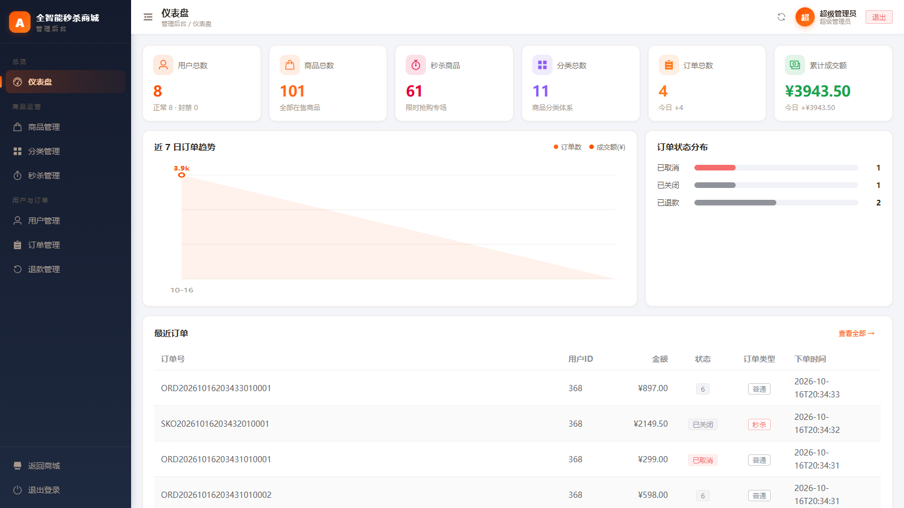
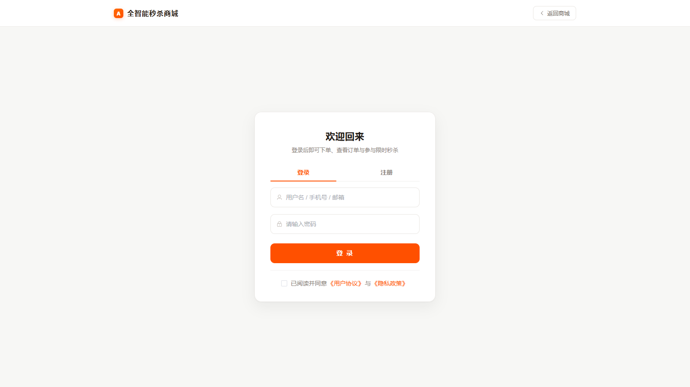

# PeakFlow · 高并发秒杀商城

> 一个以**秒杀下单**为核心链路的电商全栈项目：购买权门闩 + Redis Lua 原子预扣 + RocketMQ 异步落库 + DB 唯一索引兜底，
> 四层防线抗住瞬时高并发并杜绝超卖；另配齐订单状态机、支付资金闭环、售后退款状态机与 RBAC 权限体系。
> 前后端分离，含 123 请求 / 768 断言的 Postman 全链路测试套件。

<p align="left">
  <a href="https://github.com/we1-230/PeakFlow/actions/workflows/ci.yml"></a>
  
  
  
  
  
  
</p>

<p align="left">
  
  
  
  
  
</p>

## 界面预览

| 商城首页 | 限时秒杀 |
|---|---|
|  |  |
| **管理后台** | **登录页** |
|  |  |

> 以上均为 `docker compose up -d --build` 启动后的真实运行截图（商城端账号 `malluser / User123456`，后台 `pfadmin / Admin123456`）。

---

## 30 秒上手

```bash
git clone https://github.com/we1-230/PeakFlow.git && cd PeakFlow
cp .env.example .env        # 填 JWT_SECRET（≥32 字节随机串）；其余本地默认值可直接用
docker compose up -d --build
```

浏览器打开 **http://localhost**（唯一入口，前端 + API 由 nginx 统一提供）。

| 入口 | 地址 | 演示账号 |
|---|---|---|
| 商城端 | http://localhost/ | `malluser` / `User123456` |
| 管理后台 | http://localhost/admin/login | `pfadmin` / `Admin123456` |

> 想先看效果再看代码？按上面三步即可；想跑测试见 [§9 测试](#九测试)；
> 想本机调试（IDE 直跑后端、vite dev server）见 [§6.1](#61-前置条件) 的 `docker-compose.dev.yml` 叠加方式。
>
> 演示账号密码是**公开的示例值**，仅供本地演示（完整账号表见 [§8](#八演示账号)）；
> 生产环境不要加载 `04-demo-account.sql`。

---

## 目录

- [一、这是什么项目](#一这是什么项目)
- [二、功能模块](#二功能模块)
- [三、技术栈](#三技术栈)
- [四、系统架构](#四系统架构)
- [五、目录结构](#五目录结构)
- [六、快速开始](#六快速开始)
- [七、环境变量与三套环境](#七环境变量与三套环境)
- [八、演示账号](#八演示账号)
- [九、测试](#九测试)
- [十、关键设计说明](#十关键设计说明)
- [十一、文档索引](#十一文档索引)
- [十二、已知事项](#十二已知事项)

---

## 一、这是什么项目

PeakFlow 是一个**前后端分离的秒杀商城主站**，包含三条完整业务闭环：

| 闭环 | 链路 | 难点 |
|---|---|---|
| **秒杀抢购** | 预热 → 抢购（返回 requestId）→ 轮询结果 → 生成订单 | 超卖、一人一单、MQ 故障降级 |
| **支付资金** | 下单 → 预支付 → 第三方收银台 → 异步回调入账 → 订单已付款 | 验签、金额篡改、回调幂等、登出后旧 token 失效 |
| **退款售后** | 申请 → 管理员审核 → 发起第三方退款 → 回调 → 订单已退款 | 状态机 CAS、金额比对、中态超时收敛、部分失败可重试 |

设计上刻意**把「资金」与「库存」当成一等公民**：所有涉及钱和库存的状态流转都走乐观锁 CAS 或数据库唯一索引兜底，
不依赖 Redis 缓存（缓存会重启、会过期、会被清空）。

---

## 二、功能模块

### 商城端（`/`）

| 模块 | 页面 | 说明 |
|---|---|---|
| 首页 / 商品 | `/`、`/products`、`/product/:id` | 商品分页、分类筛选、详情 |
| **秒杀专区** | `/seckill` | 只展示「有效」秒杀商品（上架 + 活动窗口内 + 有秒杀库存），抢购后轮询结果 |
| 购物车 | `/cart` | Redis Hash 存储，勾选态前端维护 |
| 结算下单 | `/checkout` | 地址选择、多商品、下单风控配额校验 |
| 订单中心 | `/orders`、`/order/:id` | 订单列表/详情、取消、支付、确认收货、申请售后 |
| 地址管理 | `/address` | 增删改查 + 默认地址 |
| 个人中心 | `/user` | 改昵称、改密码、换头像、登录日志 |

### 管理后台（`/admin`）

| 模块 | 页面 | 所需权限 |
|---|---|---|
| 数据看板 | `/admin` | `stats:view` |
| 用户管理 | `/admin/users` | `user:manage` |
| 商品管理 | `/admin/products` | `product:manage` |
| 分类管理 | `/admin/categories` | `category:manage` |
| 秒杀管理 | `/admin/seckill` | `seckill:manage` |
| 订单管理 | `/admin/orders` | `order:read` / `order:ship` |
| 退款工作台 | `/admin/refunds` | `refund:read` / `refund:audit` / `refund:close` |

### 模拟第三方支付（MockPay）

项目内置一个**扮演支付宝角色**的模拟支付平台（`/mock-pay/**`），让资金闭环可以完全在本地跑通、不依赖任何真实支付渠道：

- `GET /mock-pay/cashier` —— 收银台页面（返回真实 HTML，保留 URL 查询参数）
- `POST /mock-pay/pay` —— 收款并**自动回调**商户 `/pay/notify`
- `POST /mock-pay/refund` —— 收款退款并回调商户 `/refund/notify`

可通过 `mock-pay.fail-rate` / `mock-pay.refund-fail-rate`（0–100）注入失败，用来验证
「回调失败时订单不会被误改成已付款」「退款失败 → 管理员重试」等异常分支。

---

## 三、技术栈

### 后端

| 类别 | 选型 |
|---|---|
| 语言 / 运行时 | Java 17 |
| 框架 | Spring Boot 2.7.18、Spring MVC、Spring AOP |
| 持久层 | MyBatis-Plus 3.5.3.1（逻辑删除、乐观锁 `@Version`）、MySQL 8.0、HikariCP |
| 缓存 / 分布式锁 | Redis 7（Lettuce 连接池）+ Redisson 3.17.7 |
| 消息队列 | RocketMQ 4.9.7（秒杀异步落库、订单超时延迟消息） |
| 安全 | Spring Security + JWT（jjwt 0.11.5）、BCrypt、RBAC 方法级鉴权 `@PreAuthorize` |
| 接口文档 | springdoc-openapi 1.8.0（Swagger UI / `/doc.html`） |
| 可观测性 | Spring Boot Actuator + Micrometer/Prometheus、SkyWalking Logback 工具包（`%tid` 链路 ID）、自建 `X-Trace-Id` 响应头 |
| 对象存储 | 阿里云 OSS SDK 3.17.4 |
| 构建 | Maven Wrapper（`mvnw` / `mvnw.cmd`，无需预装 Maven） |

### 前端

| 类别 | 选型 |
|---|---|
| 框架 | Vue 3.4（Composition API） |
| 构建 | Vite 5.3 |
| UI | Element Plus 2.7 + `@element-plus/icons-vue` |
| 状态管理 | Pinia 2.1 |
| 路由 | Vue Router 4.3（导航守卫拦截登录态 / 管理员态） |
| HTTP | axios 1.7（统一拦截器：自动注入 JWT、统一错误提示、401 静默跳登录） |
| 测试 | Vitest 2.1 + `@vue/test-utils` + MSW 2.7 + happy-dom 15.11 |

---

## 四、系统架构

```mermaid
flowchart TB
    subgraph Client["客户端"]
        B["浏览器 / Postman"]
    end

    subgraph FE["前端 · Vue 3 + Vite :3000"]
        V["商城端 + 管理后台<br/>axios baseURL=/api"]
    end

    subgraph BE["后端 · Spring Boot :8080"]
        F["TraceIdFilter<br/>JwtAuthenticationFilter"]
        C["Controller 层<br/>13 个控制器 / 71 个端点"]
        S["Service 层<br/>订单/支付/退款/秒杀"]
        SEC["Spring Security<br/>RBAC @PreAuthorize"]
    end

    subgraph MW["中间件（Docker）"]
        MY["MySQL 8.0 :3307<br/>dev/test/prod 三库"]
        RD["Redis :6380<br/>库存/缓存/黑名单"]
        MQ["RocketMQ :9876<br/>秒杀/超时"}
    end

    MOCK["MockPay<br/>模拟支付宝"]

    B --> V
    B -->|"直连 /api（Postman）"| F
    V -->|"proxy /api → :8080"| F
    F --> SEC --> C --> S
    S --> MY
    S --> RD
    S --> MQ
    S -.->|"发起支付 / 退款"| MOCK
    MOCK -.->|"异步回调 /pay/notify<br/>/refund/notify"| F

    MY -.->|"超时延迟消息"| MQ
    MQ -.->|"异步创建订单"| S
```

**请求链路说明**

1. 前端 dev 端口 `3000`，`vite.config.js` 把 `/api` 前缀重写后代理到 `localhost:8080`，
   因此后端控制器**不带 `/api` 前缀**（如前端调 `/api/auth/login` → 后端 `/auth/login`）。
2. 后端入口先过 `TraceIdFilter`（生成 traceId 写入 MDC 与响应头 `X-Trace-Id`），
   再过 `JwtAuthenticationFilter`（校验 token、比对 Redis 黑名单）。
3. 鉴权分两层：白名单（`security.white-list` + `SecurityConfig`）放行公开接口，
   其余接口经 Spring Security 认证后，再由方法级 `@PreAuthorize("hasAuthority('xxx')")` 校验权限点。

> 上图是**本机开发形态**（前端 3000、后端 8080、中间件发布调试端口）。
> **容器部署形态**下拓扑收敛为一个入口：
>
> ```mermaid
> flowchart LR
>     U["浏览器"] --> N["nginx :80<br/>唯一对外入口"]
>     N -->|"静态资源"| N
>     N -->|"/api/ 反代<br/>least_conn + max_fails"| B1["backend1 :8080"]
>     N --> B2["backend2 :8080"]
>     B1 --> MW["MySQL / Redis / RocketMQ<br/>（自定义网络内，不发布端口）"]
>     B2 --> MW
> ```
>
> 两个 backend 跑**同一个镜像**，仅靠环境变量区分（`SNOWFLAKE_WORKER_ID` 机器位、
> 各实例独立日志）；定时任务用 Redisson 分布式锁 `lock:task:*` 保证同一轮只有一个实例真正执行。
> 详见 [6.1 前置条件](#61-前置条件) 与 [9.4 容器内全量回归与专业检测](#94-容器内全量回归与专业检测)。

---

## 五、目录结构

```
PeakFlow/
├── docker-compose.yml              # 中间件 + 后端双实例 + nginx（唯一入口 :80），一条命令起全套
├── docker-compose.dev.yml          # 调试端口覆盖（3307/6380/9876/8080/8081），需显式 -f 叠加
├── .env.example                    # 环境变量模板（本文件说明见第七节）
├── .dockerignore                   # 构建上下文瘦身（排除 target / node_modules / .git 等）
├── docs/API.md                     # 接口文档（71 个端点总览）
├── backend/                        # Spring Boot 后端
│   ├── Dockerfile / .dockerignore  # 多阶段构建（maven 打包 → temurin JRE 运行）
│   ├── pom.xml
│   ├── mvnw / mvnw.cmd             # Maven Wrapper
│   ├── postman/                    # 接口测试套件（123 请求 / 768 断言）+ 权威测试规范
│   │   └── smoke_test.py           # 端到端冒烟（18 个断言点，纯标准库）
│   └── src/
│       ├── main/java/com/zhou/peakflow/
│       │   ├── controller/         # 13 个控制器，共 68 个业务端点
│       │   ├── service/ + impl/    # 业务逻辑（含 TxService 拆分的独立事务边界）
│       │   ├── mapper/             # MyBatis-Plus Mapper
│       │   ├── pojo/ dto/ vo/      # 实体 / 入参 / 出参
│       │   ├── enums/              # ResultCode、OrderStatus、RefundStatus 等
│       │   ├── config/             # Security、CORS、Redis、线程池、TraceId、消息转换器等（18 个文件）
│       │   ├── security/           # JWT 过滤器与工具
│       │   ├── consumer/           # RocketMQ 消费者（含死信处理）
│       │   ├── task/               # 定时扫表（订单超时、退款中态收敛）
│       │   ├── mockpay/            # 模拟第三方支付平台
│       │   ├── guard/              # 商品操作前置校验（在途订单 / 未完结退款）
│       │   ├── exception/          # BusinessException + 全局异常处理器
│       │   └── utils/              # JWT、签名、雪花 ID、脱敏、OSS 等
│       ├── main/resources/
│       │   ├── application.yml     # 公共配置
│       │   ├── application-dev.yml # 开发环境覆盖
│       │   ├── application-test.yml
│       │   ├── application-prod.yml# 生产环境覆盖（安全收紧）
│       │   ├── logback-spring.xml
│       │   ├── lua/                # 秒杀库存扣减 / 回补 / 重置脚本
│       │   ├── mapper/             # MyBatis XML
│       │   └── static/             # MockPay 收银台页面
│       └── test/                   # 单元测试（Mockito）+ 集成测试（SpringBootTest + MockMvc）
├── deploy/
│   ├── mysql/
│   │   ├── init/                   # 00 建三库 / 01 表结构 / 02 基础数据 / 03 商品目录 / 04 演示账号 / 05 灌 test+prod
│   │   ├── prod/grant-admin-role.sql # 生产账号授权（按用户名赋角色，4 个角色通用）
│   │   └── README.md               # 数据库初始化权威说明
│   ├── nginx/default.conf          # 宿主机 Nginx 方案（upstream 指向 127.0.0.1:8080/8081）
│   ├── rocketmq/broker.conf        # brokerIP1 模板（__BROKER_IP1__，启动时 sed 渲染）
│   ├── tester/Dockerfile           # 测试镜像：JDK + Maven + newman + python3 + redis-cli
│   └── scripts/pull-images.sh      # 国内网络拉镜像（镜像站 → retag 成规范名）
└── frontend/                       # Vue 3 前端
    ├── Dockerfile / .dockerignore  # 多阶段构建（node 打包 → nginx:alpine 托管）
    ├── nginx/default.conf          # 容器内反代 + 负载均衡（upstream backend1/backend2）
    ├── vite.config.js              # dev 端口 3000、/api 代理
    ├── package.json
    ├── src/
    │   ├── api.js                  # 全部接口定义 + axios 拦截器
    │   ├── router.js               # 路由与守卫（requiresAuth / requiresAdmin）
    │   ├── stores/                 # Pinia（auth / cart 等）
    │   ├── views/mall/             # 商城端 11 个页面
    │   ├── views/admin/            # 管理后台 8 个页面
    │   └── layouts/ components/ utils/ constants/ styles/
    └── test/                       # Vitest 单测 / 集成 / 回归
```

---

## 六、快速开始

### 6.1 前置条件

**推荐路径（容器）**：只需要 Docker，其余全部由 compose 提供。

**本机直跑路径（可选）**：JDK 17、Node.js ≥ 18、Maven 3.9；中间件仍建议用容器起。

整栈已全部编排进 `docker-compose.yml`，**一条命令起全套**：

```bash
docker compose up -d --build     # 中间件 + 后端双实例 + nginx
docker compose ps                # 7 个服务全部应为 Up (healthy)
```

> 测试与压测用的 `tester` 服务（内含 JDK / Maven / newman / python3 / redis-cli）**默认不启动**，
> 由 compose profile 控制，需要时显式带上：
>
> ```bash
> docker compose --profile test up -d tester
> ```

> **★ 对外只有一个入口**：`http://localhost`（nginx）。
> mysql / redis / rocketmq / backend1 / backend2 **都不发布宿主机端口** ——
> 外部无法直连数据库与后端实例，这是有意的收敛，也是生产部署应有的样子。

需要本机调试时，叠加 `docker-compose.dev.yml` 把调试端口放出来
（该文件**不会被 compose 自动加载**，所以不影响上面的默认形态）：

```bash
docker compose -f docker-compose.yml -f docker-compose.dev.yml up -d
```

叠加后即可：在 IDE 里直跑后端（连 127.0.0.1:3307 / 6380 / 9876）、
在宿主机跑 postman 脚本（3307）与 newman（8080）、跑前端 vite dev server（代理 8080）。

| 组件 | 版本 | 端口（默认形态） | 端口（叠加 dev 后） |
|---|---|---|---|
| nginx（唯一入口） | 1.27 | **80** | 80 |
| MySQL | 8.0 | 不发布 | **3307**（见下方说明） |
| Redis | 7 | 不发布 | 6380 |
| RocketMQ | 4.9.7 | 不发布 | 9876 / 10911 |
| backend1 / backend2 | JDK 17 | 不发布 | 8080 / 8081 |

> **为什么 MySQL 是 3307 而不是 3306**：本机 3306 常被「Windows 服务 MySQL80」占用，
> 且那个实例里往往存着别的项目的库。PeakFlow 的容器映射到 **3307** 避免互相干扰。
> Redis 用 **6380** 而非默认 6379 也是同样的理由。
>
> **RocketMQ 的 `brokerIP1` 是关键项，且分两种形态**：它决定「应用从 NameServer 拿到哪个地址去连 broker」，
> 写错的表现是**秒杀接口仍然返回 200、订单也建得出来**，只是日志里刷
> `syncSend failed ... BrokersSent: [broker-a, broker-a, broker-a]` + `MQ发送失败…直接降级同步落库`
> —— 即 **MQ 完全没参与，链路静默降级**，从接口层面完全看不出来。
>
> 因此 `deploy/rocketmq/broker.conf` 里写的是占位符 `__BROKER_IP1__`，容器启动时用 `sed` 渲染到 `/tmp/broker.conf`：
>
> | 形态 | `BROKER_IP1` 取值 | 原因 |
> |---|---|---|
> | 默认（全容器） | `broker`（服务名，compose 默认值） | 后端在容器内，拿到服务名才连得上同网络的 broker |
> | 叠加 `docker-compose.dev.yml` | `127.0.0.1` | 后端在宿主机上直跑，必须拿到宿主机视角的地址 |
>
> 渲染结果会在启动日志里打印（`[peakflow] brokerIP1 = ...`），排查时先看这一行。
>
> 国内网络拉镜像：`./deploy/scripts/pull-images.sh`（先从镜像站拉再 retag 成规范名）。

### 6.2 初始化数据库（容器化后自动完成）

用 compose 起 MySQL 时，`deploy/mysql/init/` 下的脚本会按**文件名字典序自动执行**：

| 文件 | 作用 |
|---|---|
| `00-create-databases.sql` | 建 `peakflow_dev` / `peakflow_test` / `peakflow_prod` 三个库 |
| `01-schema.sql` ~ `04-demo-account.sql` | 灌进 `MYSQL_DATABASE`（固定为 `peakflow_dev`） |
| `05-provision-envs.sh` | 再把 `01~03` 灌进 test / prod |

```bash
docker compose up -d mysql
# 应看到 peakflow_dev / peakflow_test / peakflow_prod 三个库
docker exec peakflow-mysql mysql -uroot -p1234 -e "SHOW DATABASES;"
```

> 手工灌库（不走容器）也可以，但 `01~04` 脚本里**没有 `USE` 语句**，
> 必须在命令行显式指定目标库，否则会灌进当前默认库。
> `04-demo-account.sql` 含**密码公开**的演示账号，**生产环境严禁加载**。
> 详细说明（生产环境的账号创建与授权方式、秒杀时间窗口为何用相对时间）见 [`deploy/mysql/README.md`](deploy/mysql/README.md)。

### 6.3 配置环境变量

```bash
cp .env.example .env
# 编辑 .env：至少填 JWT_SECRET（≥32 字节随机串）、DB_USERNAME / DB_PASSWORD
```

> ⚠️ 项目**未引入 spring-dotenv**，Spring Boot 不会自动读取 `.env` 文件。
> 需按下面三种方式之一把变量注入**进程环境**：IDE 的 Run Configuration、终端 `set -a; source .env; set +a`、
> 或 Docker Compose 的 `env_file`。`.gitignore` 已就位：`.env`、`logs/`、`target/`、
> `node_modules/`、`uploads/`（未配 OSS 时的本地降级上传目录）都已加入忽略。

### 6.4 启动后端

```bash
cd backend

# 方式一：Maven Wrapper（Windows 用 mvnw.cmd）
./mvnw clean package -DskipTests
java -jar target/PeakFlow-1.0-SNAPSHOT.jar --spring.profiles.active=dev

# 方式二：直接跑（IDE 里运行 Application.java，VM options 加 -Dspring.profiles.active=dev）
./mvnw spring-boot:run -Dspring-boot.run.profiles=dev

# 方式三：容器（多实例，推荐）
cd ..
docker compose up -d --build backend1 backend2
```

> ⚠️ 本机直跑时若端口不是 8080，先看环境里有没有 `SERVER_PORT`（部分沙箱/IDE 会注入 `SERVER__PORT`，
> 会被 Spring 宽松绑定成 `server.port`）。命令行参数优先级最高，可用
> `java -jar ... --server.port=8080` 强制覆盖。
>
> ⚠️ 本机直跑需要先叠加 dev 覆盖文件把 3307/6380/9876 放出来，否则连不上中间件。

启动成功后（默认形态下后端不发布端口，下面用「容器内」与「叠加 dev 后」两种方式验证）：

```bash
# 容器内自检（推荐，任何时候都可用）
docker compose exec backend1 curl -s localhost:8080/actuator/health
docker compose exec backend2 curl -s localhost:8080/actuator/health

# 经对外入口自检（走 nginx 反代）
curl -s http://localhost/api/category/list
```

| 地址（叠加 dev 后） | 说明 |
|---|---|
| http://localhost:8080/actuator/health | 健康检查（backend1） |
| http://localhost:8081/actuator/health | 健康检查（backend2） |
| http://localhost:8080/swagger-ui/index.html | Swagger UI（prod 已关闭） |
| http://localhost:8080/v3/api-docs | OpenAPI JSON |
| http://localhost:8080/actuator/prometheus | Prometheus 指标 |

> **多实例关键点**：两个容器跑的是**同一个镜像** `peakflow-backend:latest`，只靠环境变量
> `SNOWFLAKE_WORKER_ID`（1 与 2）区分雪花 ID 的机器位；定时任务用 Redisson 分布式锁（`lock:task:*`）
> 保证同一轮只有一个实例真正执行，另一个实例会打日志 `【任务名】本轮已由其他实例执行，跳过`。

### 6.5 启动前端

```bash
cd frontend
npm ci               # 严格按 package-lock.json 安装，比 npm install 更可复现
npm run dev          # http://localhost:3000（需叠加 dev 覆盖文件或本机直跑后端）
```

**容器方式（推荐）**：前端由 compose 里的 `nginx` 服务托管并反代后端，
`docker compose up -d --build` 时已一并启动，无需单独命令。

> `nginx` 是**整个系统唯一的对外入口**，只暴露 80 端口：
>
> - 静态资源（Vue 打包产物）直接由其托管，**不再有 3001 端口**；
> - `/api/` 反代到 `upstream peakflow_backend`（`backend1:8080` + `backend2:8080`，`least_conn` 策略，
>   带 `max_fails`/`fail_timeout` 故障摘除），因此前端与后端**同源**，不存在跨域问题；
> - `/api/uploads/` 由各 backend 实例直接提供。未配 OSS 时上传降级落到 `/app/uploads`，
>   两个实例**共享同一个 named volume `peakflow-uploads`**，所以「A 上传、B 回显」也能读到。

| 入口 | 本机 dev（3000） | 容器（唯一入口 80） |
|---|---|---|
| 商城端 | http://localhost:3000/ | http://localhost/ |
| 管理后台 | http://localhost:3000/admin/login | http://localhost/admin/login |
| 后端 API | 由 Vite 代理到 8080 | http://localhost/api/... |

---

## 七、环境变量与三套环境

配置采用 **「公共 + profile 覆盖」** 两层结构：`application.yml` 放公共项，
`application-{dev,test,prod}.yml` 只写差异化部分。

| 维度 | dev | test | prod |
|---|---|---|---|
| MySQL 库 | `peakflow_dev` | `peakflow_test` | `peakflow_prod` |
| Redis 逻辑库 | db0 | db1 | db2 |
| 日志目录 | `./logs/dev` | `./logs/test` | `./logs/prod` |
| 业务包日志级别 | DEBUG | INFO | INFO |
| Swagger / Knife4j | 开启 | 开启 | **关闭** |
| CORS 允许来源 | `localhost:3000` | 同左 | **默认空**，必须显式配置 |
| Actuator 暴露 | health/info/prometheus | 同左 | **仅 health**，不暴露细节 |
| JDBC `useSSL` | 不拼接 | 不拼接 | `DB_USE_SSL`（默认 true） |

**核心安全约定**：所有凭证类配置在 yml 中一律写成 `${VAR:}`（**无兜底默认值**），
未注入就直接启动失败 —— 宁可不启动，也不要带着空密钥跑起来。

完整变量清单（32 项，按域分组、含示例值与必填性标注）见 [`.env.example`](.env.example)。

---

## 八、演示账号

> 仅在加载了 `deploy/mysql/init/04-demo-account.sql` 的开发/演示环境可用。

| 账号 | 密码 | 角色 | 权限范围 |
|---|---|---|---|
| `pfadmin` | `Admin123456` | 超级管理员 | 全部 11 个权限点 |
| `sysadmin` | `Admin123456` | 超级管理员 | 全部 11 个权限点 |
| `productops` | `Ops123456` | 商品运营 | 商品/分类/秒杀/上传 + 看板 |
| `ordersvc` | `Service123456` | 订单客服 | 订单查询/发货 + 退款查询/审核 + 看板 |
| `malluser` | `User123456` | 普通用户 | 仅自己的订单/地址/购物车 |

**商城端登录**用 `malluser` 或 `pfadmin`；**管理后台**（`/admin/login`）需用带管理权限的账号（如 `pfadmin`）。

### RBAC 模型

```
user ──< user_role >── role ──< role_permission >── permission
```

- **4 个角色**：`admin`（11 权限）、`product_ops`（5）、`order_service`（5）、`user`（0）
- **11 个权限点**：`user:manage`、`stats:view`、`product:manage`、`category:manage`、`seckill:manage`、
  `order:read`、`order:ship`、`refund:read`、`refund:audit`、`refund:close`、`file:upload`
- **21 条角色-权限关联**

生产环境创建管理员的方式（**密码全程不落仓库**）：注册接口 → `deploy/mysql/prod/grant-admin-role.sql` 授权。
详见 [`deploy/mysql/README.md`](deploy/mysql/README.md)。

---

## 九、测试

### 9.1 后端接口测试（Postman / Newman）

`backend/postman/` 是**接口测试的唯一权威规范**：13 个文件夹 / 123 个请求 / 768 断言（当前 **0 失败**）。
上传类用例不要求 OSS 凭证——未配置时会自动降级写到本地 `./uploads` 并返回 `/uploads/xxx` 直链。

```bash
cd backend/postman

python seed_base_data.py         # 预置基础数据（10 分类 × 5 商品，含 10 个秒杀商品）
python setup_test_data.py        # 重置夹具（管理员密码 + 秒杀库存）
newman run PeakFlow-API.postman_collection.json -e env-test.postman_environment.json
python verify_db_redis.py        # 落库验证：DB 与 Redis 的真实副作用
```

**全容器下执行**（后端不发布宿主机端口，此时必须用 `tester` 服务）：

```bash
docker compose --profile test up -d tester

# 必须把 cwd 切到 postman 目录：集合里 src 是相对路径（fixtures/...），
# 按 cwd 解析，否则上传类用例会以 "not a multipart request" 失败
export MSYS_NO_PATHCONV=1        # Git Bash 需要，否则 -w 里的容器路径会被改写成 Windows 路径
docker compose exec -T -w /workspace/backend/postman tester sh -c '
  python3 seed_base_data.py &&
  python3 setup_test_data.py &&
  newman run PeakFlow-API.postman_collection.json -e env-test.postman_environment.json \
    --env-var baseUrl=http://nginx/api &&
  python3 verify_db_redis.py'
```

> ⚠️ 环境文件里 `baseUrl` 默认是 `http://localhost:8080`，**容器内那条地址指的是 tester 自己**，
> 会得到 `connect ECONNREFUSED 127.0.0.1:8080`。必须用 `--env-var baseUrl=http://nginx/api` 覆盖
> （经唯一入口走，顺带覆盖反代与负载均衡）。

脚本全部**环境变量驱动**（`DB_HOST`/`DB_PORT`/`REDIS_HOST`/`REDIS_PORT`/`API_BASE`/`REDIS_CLI`），
容器内由 compose 注入指向服务名与 `http://nginx/api`，本机直跑时用默认值（3307/6380/8080）。

测试按**业务链路**组织（而非「一个接口一个请求」），ID 全部靠脚本写入环境变量传递，零手工复制。
文件清单、分组设计、断言标准、变量传递与 **7 个已修复缺陷的复盘** 见 [`backend/postman/README.md`](backend/postman/README.md)。

### 9.2 前端测试（Vitest）

```bash
cd frontend
npm test                  # 单元测试（MSW 拦截 HTTP，无需后端）
npm run test:integration  # 集成测试（真联调：需要后端在跑）
npm run test:regression   # 回归测试（真联调，跑 test/regression）
npm run test:ui           # 可视化界面
```

> ⚠️ `test:integration` 与 `test:regression` 用的是 `vitest.integration.config.js`，**不装 MSW**，
> 属真联调测试：必须先按 6.1/6.4 把中间件与后端跑起来，否则会大面积 `ECONNREFUSED 127.0.0.1:8080`。
> 只有 `npm test`（`vitest.config.js`）用 MSW 拦截 HTTP，可脱离后端独立运行。

### 9.3 容器内一键冒烟（端到端）

`backend/postman/smoke_test.py` 是一条**最短的完整链路**：首页 → 注册 → 登录 → 加地址 →
商品列表 → 秒杀列表 → 秒杀下单+轮询结果 → 普通下单 → 发起支付+校验收银台地址 →
模拟支付 → 确认已付款 → 申请退款 → 管理员登录 → 审核 → 确认已退款，共 **18 个断言点**，
纯标准库（容器里无需装依赖）。

```bash
export MSYS_NO_PATHCONV=1
docker compose exec -T -w /workspace/backend/postman tester env API_BASE=http://nginx/api python3 smoke_test.py
```

> `API_BASE` 走 **`http://nginx/api`** 而不是直连某个实例：这样冒烟同时也覆盖了
> 反代链路与负载均衡。脚本会自动从 `API_BASE` 推导 `WEB_BASE`（去掉 `/api` 后缀）。

### 9.4 容器内全量回归与专业检测

```bash
export MSYS_NO_PATHCONV=1

# 1. 后端全量单测 + 集成测试（需 tester 服务）
docker compose exec -T -w /workspace/backend tester mvn test

# 2. 前端回归（真联调；经唯一入口访问后端）
cd frontend && PEAKFLOW_API_BASE=http://localhost/api npx vitest run --config vitest.integration.config.js test/regression

# 3. nginx 配置语法
docker compose exec -T nginx nginx -t

# 4. 对外入口与接口格式
curl -sI http://localhost | head -1              # 期望 HTTP/1.1 200 OK
curl -s  http://localhost/api/product/page | head -c 120   # 期望 JSON

# 5. 资源占用
docker stats --no-stream

# 6. 日志体检（干净窗口下应全部为 0）
docker compose logs backend1 backend2 | grep -cE " ERROR | 5xx "
docker compose logs backend1 backend2 | grep -c "syncSend failed"
docker compose logs backend1 backend2 | grep -c "降级同步落库"

# 7. 重启后仍正常
docker compose --profile test down && docker compose up -d && docker compose ps
```

**负载均衡行为验证**（含故障摘除）：

```bash
# 打 20 次，观察两个实例日志都在输出（least_conn 应基本均分）
for i in $(seq 1 20); do curl -s -o /dev/null -w "%{http_code} " http://localhost/api/product/page; done

# 停掉 backend2：请求应全部 200 并落到 backend1（max_fails 生效）
docker compose stop backend2
for i in $(seq 1 10); do curl -s -o /dev/null -w "%{http_code} " http://localhost/api/product/page; done
docker compose start backend2
```

**重复定时任务验证**（多实例下同一轮只应执行一次）：人为占住 Redisson 锁，
两个实例都应打出「本轮已由其他实例执行，跳过」：

```bash
docker compose exec -T redis redis-cli HSET lock:task:order-sweep:timeout-pending dummy 1
docker compose exec -T redis redis-cli PEXPIRE lock:task:order-sweep:timeout-pending 75000
docker compose logs backend1 backend2 | grep "本轮已由其他实例执行"
```

---

## 十、关键设计说明

### 10.1 秒杀：四层防线 + 异步削峰

```
① 购买权门闩（Redis）      同一用户同一商品只允许一单
② Redis 预扣库存（Lua）    单线程原子扣减，杜绝并发超卖
③ RocketMQ 异步落库        请求立即返回 requestId，前端轮询结果
④ DB 唯一索引兜底           seckill_slot 生成列 + uk_seckill_user_product
                           —— 不依赖 Redis（Key 会重启/过期/被清空）
```

**MQ 故障降级**：当 MQ 发送失败时降级为同步落库，且**刻意不回滚 Redis 预扣**——
因为降级同步落库会照常扣减 DB 库存，两边各扣 1 才一致；若回滚 Redis 就会造成
「Redis 还回去、DB 照扣」的库存漂移。原则是：**Redis 预扣是「占名额」，只有名额最终没被用掉时才回滚。**

### 10.2 库存预热与自愈

应用启动时**不会**自动把秒杀库存写进 Redis。首次下单若发现库存 Key 缺失（Lua 返回 `-2`），
会从 DB 重建后重试一次，实现自愈；也可由管理员调用 `GET /seckill/preheat/all` 全量预热。

### 10.3 订单与退款状态机

**订单状态**（`OrderStatus`）：`0 待付款 → 1 已付款 → 2 已发货 → 3 已完成`，
分支 `4 已取消`、`5 已关闭`（超时）、`6 已退款`。在途状态 SQL 常量 `0,1,2`。

**退款状态**（`RefundStatus`）：`0 待审核 / 1 退款中 / 2 退款成功 / 3 退款失败 / 4 已驳回 / 5 用户已撤销 / 6 已作废 / 7 待用户退货`。
中间态用 `OPEN_STATUS_SQL = "0,1,3,7"` 定义「未完结」，用 `CANCELLABLE_STATUS_SQL = "0,7"` 控制可撤销范围。

所有状态流转都走**乐观锁 CAS**（`UPDATE ... WHERE status = ?`）或 SQL 层条件约束，而非「先查后改」。

### 10.4 退款中态超时收敛

退款单最怕永久卡在「退款中」。项目用配置化的四条规则兜底（见 `refund.*`）：

| 配置 | 作用 |
|---|---|
| `retry-delay-minutes: 30` | 进入「退款中」后至少等 30 分钟才允许重试（防手抖 + 给自动重试限频） |
| `auto-retry-max-minutes: 360` | 超过 6 小时不再自动重试，只告警，转人工 |
| `applying-timeout-days: 7` | 「待审核」超 7 天自动驳回，释放「一订单一未完结退款单」名额 |
| `wait-return-timeout-days: 30` | 「待用户退货」超 30 天自动作废 |

### 10.5 下单风控：按「状态配额」而非「创建频率」

限流「下单频率」可以被「等一会儿再来」绕过；限制**同时持有的待付款订单数**则绕不过去。

| 配置 | 默认 | 作用 |
|---|---|---|
| `max-unpaid-orders` | 5 | 单用户同时可持有的待付款订单上限，支付/取消/超时后自动归还 |
| `abandon-window-days` | 7 | 统计窗口 |
| `abandon-per-penalty` | 5 | 窗口内每 5 次「超时未支付」配额收紧 1 笔（主动取消不计） |
| `max-quota-penalty` | 4 | 最多收紧 4 笔 |
| `min-unpaid-quota` | 1 | 配额下限，真正的封禁走封号流程 |

### 10.6 资金闭环的三道防线

| 防线 | 手段 |
|---|---|
| 真实性 | 回调**验签**（`MOCK_PAY_SECRET`）+ 时间戳防重放 |
| 正确性 | **金额比对**：回调金额必须与本地支付单一致，防改价攻击 |
| 幂等性 | 状态机 **CAS**：重复回调不产生副作用；重复预支付复用同一 `outTradeNo` |

### 10.7 接口响应格式恒定 JSON（已排除 XML 转换器）

本项目**没有任何对外 XML 接口**，但依赖 `com.aliyun:alibabacloud-oss-v2` 把
`jackson-dataformat-xml` 传递引进了 classpath，Spring MVC 据此自动注册了
`MappingJackson2XmlHttpMessageConverter`。由于内容协商会按客户端 Accept 的**顺序**挑格式，
同一个接口出现了两种响应：

| 调用方 | Accept 里的顺序 | 实际拿到 |
|---|---|---|
| 浏览器 / axios | `application/json` 在前 | JSON |
| Java `RestTemplate` | `application/xml`、`text/xml` 在 `application/json` **之前** | **XML** |

**它造成的真实缺陷**：`RefundServiceImpl` 用 `RestTemplate` 调第三方退款接口，收到的是
`<Map><success>true</success><message>退款受理成功，结果已通知商户</message></Map>`。
应答明明是「已受理」，却因为解析不出 JSON 被当成「未受理」，退款单被写成「退款失败」——
**钱已经退给用户了**。这次侥幸没造成资损，只是因为异步回调先到、CAS 的 `WHERE status = 1` 已不满足。

三层修复：

| 层 | 措施 |
|---|---|
| 治本 | `MessageConverterConfig` 把 XML 转换器从 MVC 转换器链里摘掉，所有接口恒定 JSON（OSS SDK 用自带 ObjectMapper 解析 XML，不受影响） |
| 显式 | `MockPayController` 的 `/pay`、`/refund` 加 `produces = application/json`（它模拟的是 JSON 渠道） |
| 客户端 | `RefundServiceImpl` 显式 `Accept: application/json`，不再依赖转换器链推导 |

**判定逻辑也一并改成三态**（`ACCEPTED` / `REJECTED` / `UNKNOWN`）：
只有第三方**明确拒绝**才允许置为失败；「读不懂应答」必须保留中间态交给回调或兜底重发收敛。
原先的「解析失败 ⇒ 视为未受理 ⇒ 置失败」与 10.4 自己写下的原则
（「钱可能已经退了，绝不自动判失败」）是矛盾的。

回归测试：`MockPayResponseFormatIntegrationTest` 用 `RestTemplate` 真实的 Accept 原样打接口，
断言必须返回 JSON —— XML 转换器若因任何新依赖回到 classpath，用例会立刻变红。

---

## 十一、文档索引

| 文档 | 内容 |
|---|---|
| [`docs/API.md`](docs/API.md) | **接口文档**：通用约定、业务码表、状态机枚举、71 个端点总览、核心链路请求响应示例、权限对照 |
| [`backend/postman/README.md`](backend/postman/README.md) | 接口测试权威规范：分组设计、断言标准、变量传递、7 个已修复缺陷复盘 |
| [`deploy/mysql/README.md`](deploy/mysql/README.md) | 数据库初始化：五层文件切分、演示/生产两场景、生产账号授权三步法 |
| [`.env.example`](.env.example) | 环境变量模板：32 项变量按域分组，含必填性与生产注意事项 |

---

## 十二、已知事项

以下为走查后**已识别、尚未处置**的事项，如实记录：

| 事项 | 说明 |
|---|---|
| 演示密码明文散落 | `04-demo-account.sql`、`deploy/mysql/README.md`、`postman/README.md` 等多处含演示账号明文密码（仅演示用，生产不加载该 SQL） |
| 脚本内的本地库密码默认值 | `postman/*.py` 已全部改为环境变量驱动，但 `DB_PASSWORD` / `MOCK_PAY_SECRET` 仍带**本地开发用**的兜底默认值；生产环境务必显式注入 |
| 本机直跑后端时不共享上传目录 | 容器形态已用 named volume `peakflow-uploads` 打通（见下），但若把后端改成本机直跑（`./uploads`）同时又有容器实例在读，两边目录不互通。混用时请统一到容器，或配 OSS |
| 雪花 ID 生成器暂无调用点 | 业务主键走 `id-type: auto` 自增，`SnowflakeIdGenerator` 已具备多实例分片能力但当前无人调用 |

> 项目**已包含**：`docker-compose.yml`、`docker-compose.dev.yml`（调试端口覆盖，**不会**被自动加载）、
> `.dockerignore`、`backend/Dockerfile`、`frontend/Dockerfile`、`frontend/nginx/default.conf`、
> `deploy/nginx/default.conf`（宿主机 Nginx 方案）、`deploy/rocketmq/broker.conf`（`brokerIP1` 模板）、
> `deploy/tester/Dockerfile`（含 JDK/Maven/newman/python3/redis-cli 的测试镜像）、
> `deploy/scripts/pull-images.sh`、`backend/postman/smoke_test.py`（端到端冒烟）。
> `.gitignore` 与 `.gitattributes` 已就位。
>
> 已处置：早期版本遗留的 `/agent/session/**` 匿名放行与一组从未被代码读取的
> `agent.*` 配置，已连同 Agent 会话模块、Postman 用例与 `session_summary` 表一并移除。
> 历史拼写笔误 `plekflow_prod`（少一个 `a`）也已随初始化脚本整改一并修正。
>
> 已处置：**未配 OSS 时多实例读不到对方上传的文件**。此前 nginx 用 `least_conn` 分发，
> 「上传」与随后的「回显读取」会落到不同实例，实例 B 的 `/uploads/**` 里没有实例 A 写的文件，
> 表现为头像上传成功但回显 404（且只有约一半概率复现）。现在两个 backend 共享 named volume
> `peakflow-uploads`（挂到 `/app/uploads`），已连跑三轮联调验证不再出现。
> 生产多实例仍建议直接上 OSS，共享卷只是无凭证时的兜底。

---

## License

本项目仅用于学习与技术演示。内置的商品图片来自 Unsplash 公开可商用素材；
演示账号与 MockPay 密钥均为**示例值，不具备任何真实安全性**，请勿用于生产环境。
