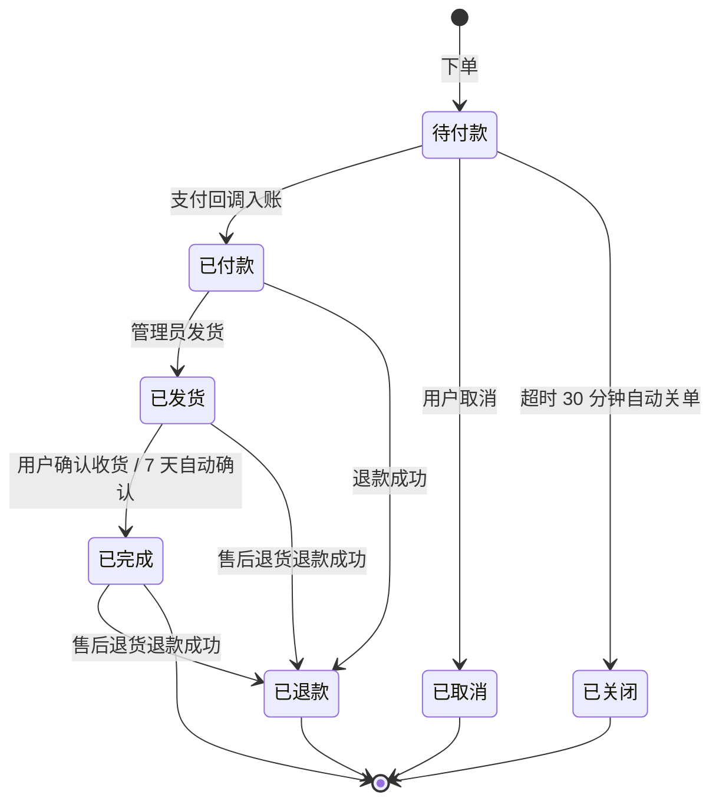
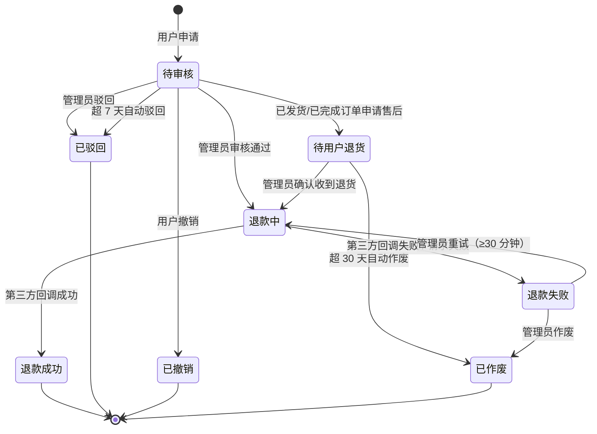
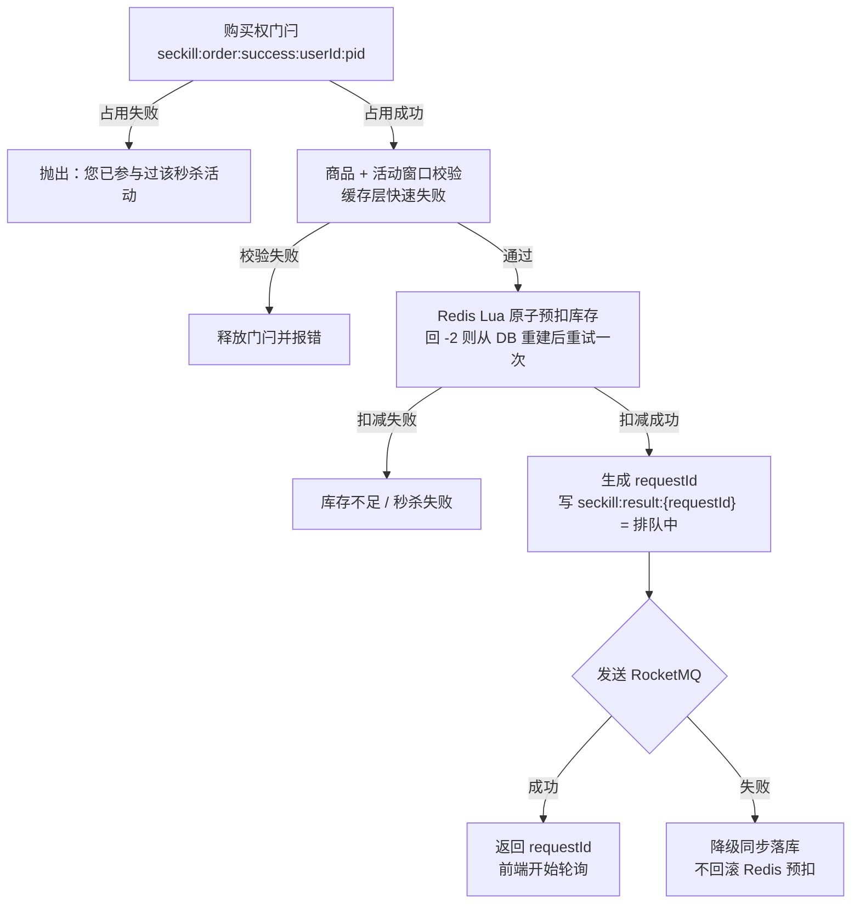

# PeakFlow 接口文档

> 版本：v1.0 ｜ 对应后端：`PeakFlow-1.0-SNAPSHOT`（Spring Boot 2.7.18）
> 本文档由代码实测导出，端点数与 `backend/src/main/java/com/zhou/peakflow` 下的控制器一一对应。

---

## 目录

- [一、通用约定](#一通用约定)
- [二、认证方式](#二认证方式)
- [三、统一响应结构](#三统一响应结构)
- [四、业务码表](#四业务码表)
- [五、状态机枚举](#五状态机枚举)
- [六、权限码与角色对照](#六权限码与角色对照)
- [七、端点总览](#七端点总览)
- [八、核心链路详解](#八核心链路详解)
- [九、模拟第三方支付（MockPay）](#九模拟第三方支付mockpay)
- [十、免登录白名单](#十免登录白名单)

---

## 一、通用约定

| 项 | 约定 |
|---|---|
| 协议 / 格式 | HTTP，请求与响应体均为 `application/json;charset=UTF-8` |
| 后端地址（dev） | `http://localhost:8080` |
| 前端访问路径 | 前端 `axios` 的 `baseURL = /api`，dev 下 Vite 将 `/api` **重写剥掉前缀**后代理到 `:8080`。**后端路由本身不含 `/api`**（如前端请求 `/api/auth/login` 实际打到后端 `/auth/login`） |
| HTTP 状态码 | **业务响应恒为 200**，成功与否由响应体中的 `code` 区分（`/pay/notify`、`/refund/notify` 例外，见下） |
| 认证 | 请求头 `Authorization: Bearer <token>` |
| 链路追踪 | 响应头固定回传 `X-Trace-Id`，排障时凭此串起全链路日志 |
| 日期时间格式 | `yyyy-MM-dd HH:mm:ss`，时区 `GMT+8` |
| 金额 | `BigDecimal`，单位为元 |
| 分页入参 | `pageNum`（页码，≥1，默认 1）、`pageSize`（每页条数，1–100，默认 10） |
| 分页出参 | `PageVo`，见下 |
| 文件上传 | `multipart/form-data`，单文件上限 **2 MB**（`spring.servlet.multipart.max-file-size`） |
| 逻辑删除 | 所有业务表用 `deleted` 字段（0 未删除 / 1 已删除），查询自动过滤 |

### 分页出参结构 `PageVo<T>`

```json
{
  "list": [],
  "total": 0,
  "pages": 0,
  "pageNum": 1,
  "pageSize": 10
}
```

### 非标准响应（不走 `Result`）

| 接口 | Content-Type | 返回体 | 说明 |
|---|---|---|---|
| `POST /pay/notify` | `text/plain` | `success` / `failure` | 第三方支付回调的应答，必须严格按字面量返回 |
| `POST /refund/notify` | `text/plain` | `success` / `failure` | 第三方退款结果回调的应答 |
| `GET /mock-pay/cashier` | `text/html` | 收银台页面 HTML | 直接返回页面内容，URL 查询参数原样保留 |
| `POST /mock-pay/pay`、`POST /mock-pay/refund` | `application/json` | `{ "success": true, "message": "..." }` | 模拟第三方的自有响应格式 |

---

## 二、认证方式

全站采用**单一鉴权通道：无状态 JWT**。

| 通道 | 凭证 | 适用对象 | 说明 |
|---|---|---|---|
| 用户 JWT | `Authorization: Bearer <token>` | 商城用户、管理员 | 登录/注册/刷新接口签发；无状态校验 + Redis 黑名单 |

**权限两层校验**

1. **URL 层**（`SecurityConfig` + `security.white-list`）：白名单直接放行，其余要求已认证。
2. **方法层**（`@PreAuthorize("hasAuthority('xxx')")`）：控制器方法上声明所需**权限点**，无权限返回 `403 / code=403`。

**Token 失效场景**：登出、改密强制下线后 token 进入 Redis 黑名单（`token:blacklist`）；
校验时若命中黑名单立即失效。JWT 含随机 `jti`，保证同一秒内签发的 token 也不相同。

**登录态相关缓存 Key**

| Key | 含义 | 过期 |
|---|---|---|
| `login:user:{username}` | 登录用户信息缓存 | 24 小时 |
| `login:fail:{username}` | 登录失败计数 | 60 分钟 |
| `login:lock:{username}` | 账号锁定标记 | 15 分钟 |
| `token:blacklist` | 已失效 token 集合 | 随 token 剩余有效期 |
| `captcha:{uuid}` | 图形验证码 | 120 秒 |

---

## 三、统一响应结构

```json
{
  "code": 200,
  "message": "操作成功",
  "data": {},
  "timestamp": 1760000000000
}
```

| 字段 | 类型 | 说明 |
|---|---|---|
| `code` | Integer | 业务码，成功恒为 `200`；错误码见第四节 |
| `message` | String | 提示文案，可直接展示给用户 |
| `data` | 泛型 | 业务数据，无返回内容时为 `null` |
| `timestamp` | Long | 服务端毫秒时间戳 |

> 前端 `axios` 响应拦截器约定：`code === 200` 时**自动解包 `data`**；
> `code === 401` 时静默清除本地登录态并跳转登录页（管理端跳 `/admin/login`）；
> 其余非 200 一律弹出 `message` 错误提示。

---

## 四、业务码表

> 来源：`com.zhou.peakflow.enums.ResultCode`。**编号按域分段**，新增错误码请落在对应区间，
> 已发布的 `3000`–`3004` 禁止改号（前端与测试套件已依赖）。

### 成功

| code | message |
|---|---|
| 200 | 操作成功 |

### 客户端错误 4xx

| code | message |
|---|---|
| 400 | 请求参数错误 |
| 401 | 未认证，请先登录 |
| 403 | 无权限访问 |
| 404 | 资源不存在 |

### 参数错误 1000–1999

| code | message |
|---|---|
| 1000 | 参数错误 |
| 1001 | 参数缺失 |
| 1002 | 参数格式错误 |
| 1003 | 参数校验失败 |

### 用户 / 认证 2000–2999

| code | message |
|---|---|
| 2000 | 用户未登录 |
| 2001 | 用户不存在 |
| 2002 | 用户名或密码错误 |
| 2003 | 账号已禁用 |
| 2004 | 用户名已存在 |
| 2005 | 邮箱已存在 |
| 2006 | token 无效 |
| 2007 | token 已过期 |
| 2008 | 登出失败 |

### 业务错误 3000–3999

| code | message | 备注 |
|---|---|---|
| 3000 | 库存不足 | 历史号，禁止改 |
| 3001 | 请勿重复秒杀 | 历史号 |
| 3002 | 秒杀失败 | 历史号 |
| 3003 | 订单不存在 | 历史号 |
| 3004 | 订单创建失败 | 历史号 |
| 3005 | 业务处理失败 | |
| 3006 | 订单状态不允许此操作 | |
| 3007 | 无权操作此订单 | 越权 |
| 3008 | 商品库存不足 | |
| 3009 | 商品不存在 | |
| 3010 | 商品已下架 | |
| 3011 | 商品名称已存在 | |
| 3012 | 地址不存在 | |
| 3013 | 地址不属于当前用户 | |
| 3014 | 该地址已存在 | |
| 3015 | 没有默认地址 | |
| 3016 | 分类名称已存在 | |
| 3017 | 分类下有商品，无法操作 | |

**下单风控 3018–3019**

| code | message |
|---|---|
| 3018 | 待支付订单过多，请先完成支付或取消后再下单 |

**支付 3020–3029**

| code | message |
|---|---|
| 3020 | 支付单不存在 |
| 3021 | 支付金额与订单金额不一致 |
| 3022 | 支付签名校验失败 |
| 3023 | 支付单状态不允许此操作 |
| 3024 | 不支持的支付渠道 |
| 3025 | 支付结果通知处理失败 |

**退款 3030–3049**

| code | message |
|---|---|
| 3030 | 退款单不存在 |
| 3031 | 退款单当前状态不允许此操作 |
| 3032 | 退款金额不合法 |
| 3033 | 该订单已有退款申请正在处理中 |
| 3034 | 当前订单不满足退款条件 |
| 3035 | 已超过可退款期限 |
| 3036 | 无权操作此退款单 |
| 3037 | 退款结果通知处理失败 |
| 3038 | 未找到该订单的支付成功流水，无法退款 |
| 3039 | 发起第三方退款请求失败 |
| 3040 | 退货退款需填写退货物流公司与退货单号 |
| 3042 | 该退款单类型不支持此操作 |

### 缓存错误 4000–4999

| code | message |
|---|---|
| 4000 | 缓存穿透 |
| 4001 | 缓存击穿 |
| 4002 | 缓存雪崩 |

### 系统错误 5000–5999

| code | message |
|---|---|
| 5000 | 系统繁忙，请稍后重试 |
| 5001 | 数据库异常 |
| 5002 | 缓存异常 |
| 5003 | 消息队列异常 |
| 5004 | 获取锁失败 |

---

## 五、状态机枚举

### 订单状态 `OrderStatus`

| 值 | 常量 | 含义 | 终态 |
|---|---|---|---|
| 0 | `UNPAID` | 待付款 | |
| 1 | `PAID` | 已付款 | |
| 2 | `SHIPPED` | 已发货 | |
| 3 | `COMPLETED` | 已完成 | |
| 4 | `CANCELLED` | 已取消（用户主动） | ✅ |
| 5 | `CLOSED` | 已关闭（超时未付款） | ✅ |
| 6 | `REFUNDED` | 已退款 | ✅ |

- **在途状态**：`0,1,2`（用于「商品能否删除/下架」占用校验）
- 可取消：`canCancel`；可支付：`canPay`；可申请退款：`canRefund`
- 流转全部走**乐观锁 CAS**（`UPDATE ... WHERE status = ?`），失败即并发冲突

**订单状态流转图**



### 退款单状态 `RefundStatus`

| 值 | 常量 | 含义 |
|---|---|---|
| 0 | `APPLYING` | 待审核 |
| 1 | `REFUNDING` | 退款中 |
| 2 | `SUCCESS` | 退款成功 |
| 3 | `FAILED` | 退款失败（可重试 / 可作废） |
| 4 | `REJECTED` | 已驳回 |
| 5 | `CANCELLED` | 用户已撤销 |
| 6 | `VOIDED` | 已作废 |
| 7 | `WAIT_RETURN` | 待用户退货 |

- **未完结**（占用「一订单一未完结退款单」名额）：`0,1,3,7` → `OPEN_STATUS_SQL`
- **可撤销**：`0,7` → `CANCELLABLE_STATUS_SQL`
- 可审核：`canAudit`；可撤销：`canCancel`；可确认收货：`canConfirmReturn`；可重试：`canRetry`；可作废：`canClose`

**退款状态流转图**



### 秒杀结果状态 `SeckillResultVo.status`

| 值 | 含义 | 附带字段 |
|---|---|---|
| 0 | 排队中 | — |
| 1 | 抢购成功 | `orderId`、`orderNo` |
| 2 | 抢购失败 | `failReason` |

### 其他常用枚举

| 枚举类 | 字段 | 取值 |
|---|---|---|
| `ProductShelfStatus` | `Product.status` | 0 下架 / 1 上架 |
| `SeckillFlag` | `Product.isSeckill` | 0 否 / 1 是 |
| `UserAccountStatus` | `User.status` | 0 禁用 / 1 启用 |
| `PayStatus` | `PayRecord.status` | 0 待支付 / 1 支付成功 / 2 已关闭 / 3 已退款 |
| `RefundType` | `RefundRecord.refundType` | 1 仅退款 / 2 退货退款（**由服务端按订单状态推导，客户端无权指定**） |
| — | `Order.orderType` | 0 普通订单 / 1 秒杀订单 |
| — | `Address.isDefault` | 0 否 / 1 是 |

> `PayStatus` 与订单状态**相互独立**：一张支付单 = 一次向第三方发起收款的尝试。
> 订单取消或超时关单时支付单会同步置为「已关闭」，此后不再接受任何支付回调。

---

## 六、权限码与角色对照

### 11 个权限点

| 权限码 | 名称 |
|---|---|
| `user:manage` | 用户管理 |
| `stats:view` | 数据看板 |
| `product:manage` | 商品管理 |
| `category:manage` | 分类管理 |
| `seckill:manage` | 秒杀管理 |
| `order:read` | 订单查询 |
| `order:ship` | 订单发货 |
| `refund:read` | 退款查询 |
| `refund:audit` | 退款审核 |
| `refund:close` | 退款作废 |
| `file:upload` | 图片上传 |

### 4 个角色 → 权限

| 角色 code | 名称 | 权限数 | 权限清单 |
|---|---|---|---|
| `admin` | 超级管理员 | 11 | 全部 |
| `product_ops` | 商品运营 | 5 | `product:manage`、`category:manage`、`seckill:manage`、`file:upload`、`stats:view` |
| `order_service` | 订单客服 | 5 | `order:read`、`order:ship`、`refund:read`、`refund:audit`、`stats:view` |
| `user` | 普通用户 | 0 | 仅能操作自己的订单 / 地址 / 购物车 |

> 注意：`order_service` **不含** `refund:close`——客服可以审核退款，但不能作废退款单。

---

## 七、端点总览

**共 71 个端点**：13 个业务控制器 68 个 + MockPay 模拟第三方 3 个。

图例：🔓 = 免登录；🔒 = 需登录；🔑 = 需指定权限点。

### 7.1 认证 `/auth`（6）

| 方法 | 路径 | 说明 | 鉴权 |
|---|---|---|---|
| GET | `/auth/image` | 获取图形验证码（返回 `CaptchaVO`） | 🔓 |
| POST | `/auth/login` | 账号密码登录 | 🔓 |
| POST | `/auth/register` | 用户注册 | 🔓 |
| POST | `/auth/refresh` | 刷新 token | 🔒 |
| POST | `/auth/logout` | 登出（token 入黑名单） | 🔒 |
| POST | `/auth/changePassword` | 重置后的强制改密（按用户名）；仅本人或 `user:manage` 可调 | 🔒 |

### 7.2 用户 `/user`（5）

| 方法 | 路径 | 说明 | 鉴权 |
|---|---|---|---|
| GET | `/user/info` | 获取当前用户信息 | 🔒 |
| POST | `/user/avatar` | 上传头像（multipart） | 🔒 |
| POST | `/user/nickname` | 修改昵称（query `nickname`） | 🔒 |
| POST | `/user/password` | 自助改密（校验旧密码） | 🔒 |
| POST | `/user/loginLog` | 登录日志分页查询 | 🔒 |

**`/user/loginLog` 响应字段（2026-10-17 校正）**

登录日志对应 `login_log` 表，**只有 6 个字段**，没有 `status` / `location` / `device`：

```json
{
  "list": [
    { "id": 47, "userId": 32, "username": "malluser",
      "ip": "223.104.150.216", "loginTime": "2026-10-17 10:30:51", "remark": "登录成功" }
  ],
  "total": 12, "pages": 2, "pageNum": 1, "pageSize": 10
}
```

- 日志**仅在登录成功后异步写入**（`UserServiceImpl#login` 第 10 步），故 `remark` 恒为「登录成功」；
  前端展示「状态」应读 `remark`，**不要读不存在的 `status`**（曾因此把成功显示成失败）。


### 7.3 地址 `/address`（6）

| 方法 | 路径 | 说明 | 鉴权 |
|---|---|---|---|
| GET | `/address/list` | 当前用户全部地址 | 🔒 |
| GET | `/address/default` | 当前用户默认地址 | 🔒 |
| POST | `/address/add` | 新增地址 | 🔒 |
| PUT | `/address/update` | 更新地址 | 🔒 |
| DELETE | `/address/delete/{id}` | 删除地址 | 🔒 |
| PUT | `/address/default/{id}` | 设为默认地址 | 🔒 |

### 7.4 商品 `/product`（6）

| 方法 | 路径 | 说明 | 鉴权 |
|---|---|---|---|
| POST | `/product/page` | 商品分页列表（支持分类、关键词） | 🔓 |
| GET | `/product/detail/{id}` | 商品详情；**id 不存在时返回 `code=3005 商品不存在`**（2026-10-17 起，不再返回 `200 + data:null`） | 🔓 |
| POST | `/product/add` | 新增商品 | 🔑 `product:manage` |
| PUT | `/product/update` | 更新商品 | 🔑 `product:manage` |
| PUT | `/product/status/{id}` | 上下架（query `status`）；**秒杀商品会被拒绝** | 🔑 `product:manage` |
| DELETE | `/product/delete/{id}` | 删除商品（在途订单/未完结退款占用时拒绝） | 🔑 `product:manage` |

**⚠️ `stock` 与 `seckillStock` 是两个独立库存，前端勿混用（2026-10-17）**

| 字段 | 含义 | 普通商品 | 秒杀商品 |
|---|---|---|---|
| `stock` | 普通库存 | 真实可售量 | **恒为 0** |
| `seckillStock` | 秒杀库存 | 无意义（可为 null） | 真实可抢量 |

`isSeckill=1` 时页面展示与售罄判断都必须读 `seckillStock`；
只有秒杀通道能售卖该商品，且**同一用户限购 1 件**（`order.uk_seckill_user_product` 唯一索引保证）。

### 7.5 分类 `/category`（4）

| 方法 | 路径 | 说明 | 鉴权 |
|---|---|---|---|
| GET | `/category/list` | 全部分类 | 🔓 |
| POST | `/category/add` | 新增分类 | 🔑 `category:manage` |
| PUT | `/category/update` | 更新分类 | 🔑 `category:manage` |
| DELETE | `/category/delete/{id}` | 删除分类（分类下有商品时拒绝） | 🔑 `category:manage` |

### 7.6 购物车 `/cart`（5）

| 方法 | 路径 | 说明 | 鉴权 |
|---|---|---|---|
| GET | `/cart/list` | 购物车列表 | 🔒 |
| POST | `/cart/add` | 加入购物车（query `productId`、`quantity`） | 🔒 |
| POST | `/cart/updateQuantity` | 修改数量（query `productId`、`quantity`） | 🔒 |
| DELETE | `/cart/delete/{productId}` | 删除单项 | 🔒 |
| DELETE | `/cart/clear` | 清空购物车 | 🔒 |

> 勾选态存储在服务端 Redis（`/cart/list` 返回 `selected`），但**后端未暴露修改勾选的接口**，
> 勾选由前端本地维护（`stores/cart.js`）。

### 7.7 订单 `/order`（8）

| 方法 | 路径 | 说明 | 鉴权 |
|---|---|---|---|
| POST | `/order/create` | 创建普通订单（多商品） | 🔒 |
| POST | `/order/list` | 我的订单分页 | 🔒 |
| GET | `/order/detail/{orderId}` | 订单详情 | 🔒 |
| POST | `/order/cancel/{orderId}` | 取消订单 | 🔒 |
| POST | `/order/confirm/{orderId}` | 确认收货 | 🔒 |
| POST | `/order/refund/{orderId}` | 申请退款/售后（旧入口，返回退款单 id） | 🔒 |
| POST | `/order/admin/list` | 管理端订单分页查询 | 🔑 `order:read` |
| PUT | `/order/admin/update` | 管理端更新订单（发货 / 改物流） | 🔑 `order:ship` |

### 7.8 支付 `/pay`（3）

| 方法 | 路径 | 说明 | 鉴权 |
|---|---|---|---|
| POST | `/pay/prepay` | 发起支付，返回收银台地址 | 🔒 |
| GET | `/pay/query/{outTradeNo}` | 查询支付结果（前端轮询） | 🔒 |
| POST | `/pay/notify` | 支付结果异步通知（第三方回调） | 🔓 验签保护 |

### 7.9 退款售后 `/refund`（11）

| 方法 | 路径 | 说明 | 鉴权 |
|---|---|---|---|
| POST | `/refund/apply` | 用户申请退款/售后 | 🔒 |
| POST | `/refund/list` | 我的退款单分页 | 🔒 |
| GET | `/refund/detail/{refundId}` | 退款单详情 | 🔒 |
| POST | `/refund/cancel/{refundId}` | 撤销退款申请（仅「待审核」） | 🔒 |
| POST | `/refund/admin/list` | 管理端退款单分页 | 🔑 `refund:read` |
| GET | `/refund/admin/detail/{refundId}` | 管理端退款单详情 | 🔑 `refund:read` |
| POST | `/refund/admin/audit` | 审核退款（通过 → 自动发起退款） | 🔑 `refund:audit` |
| POST | `/refund/admin/confirm-return/{refundId}` | 确认收到退货（售后退款放款） | 🔑 `refund:audit` |
| POST | `/refund/admin/retry/{refundId}` | 重新发起退款（仅「退款失败」） | 🔑 `refund:audit` |
| POST | `/refund/admin/close/{refundId}` | 作废退款单（仅「退款失败」） | 🔑 `refund:close` |
| POST | `/refund/notify` | 退款结果异步通知 | 🔓 验签保护 |

### 7.10 秒杀 `/seckill`（8）

| 方法 | 路径 | 说明 | 鉴权 |
|---|---|---|---|
| POST | `/seckill/list` | 秒杀商品分页（仅有效活动：上架 + 窗口内 + 有库存） | 🔓 |
| GET | `/seckill/detail/{id}` | 秒杀商品详情 | 🔓 |
| POST | `/seckill/order` | 秒杀下单（返回 requestId） | 🔒 |
| POST | `/seckill/result/{requestId}` | 轮询秒杀结果 | 🔒 |
| GET | `/seckill/preheat/all` | 全量秒杀库存预热 | 🔑 `seckill:manage` |
| POST | `/seckill/add` | 新增秒杀商品 | 🔑 `seckill:manage` |
| PUT | `/seckill/update` | 更新秒杀商品（含库存） | 🔑 `seckill:manage` |
| DELETE | `/seckill/delete/{id}` | 删除秒杀商品（活动期内拒绝） | 🔑 `seckill:manage` |

### 7.11 管理端 `/admin`（5）

| 方法 | 路径 | 说明 | 鉴权 |
|---|---|---|---|
| GET | `/admin/dashboard/stats` | 仪表盘统计 | 🔑 `stats:view` |
| POST | `/admin/list` | 用户分页查询 | 🔑 `user:manage` |
| POST | `/admin/ban` | 封禁用户（query `userId`） | 🔑 `user:manage` |
| POST | `/admin/unban` | 解封用户（query `userId`） | 🔑 `user:manage` |
| POST | `/admin/resetPassword` | 重置用户密码（query `userId`） | 🔑 `user:manage` |

### 7.12 文件上传 `/upload`（1）

| 方法 | 路径 | 说明 | 鉴权 |
|---|---|---|---|
| POST | `/upload/image` | 上传图片，返回 URL | 🔑 `file:upload` |

### 7.13 模拟第三方 `/mock-pay`（3）

| 方法 | 路径 | 说明 | Content-Type |
|---|---|---|---|
| GET | `/mock-pay/cashier` | 收银台页面 | `text/html` |
| POST | `/mock-pay/pay` | 模拟收款并自动回调 `/pay/notify` | `application/json` |
| POST | `/mock-pay/refund` | 模拟退款并回调 `/refund/notify` | `application/json` |

---

## 八、核心链路详解

### 8.1 认证链路

#### 获取图形验证码 `GET /auth/image`

🔓 无需认证

**响应**

```json
{
  "code": 200,
  "message": "操作成功",
  "data": {
    "captchaUuid": "3f1c2a70-9b4e-4c1d-8a2e-6f0b1d2c3a4b",
    "imageBase64": "data:image/png;base64,iVBORw0KGgo..."
  },
  "timestamp": 1760000000000
}
```

> 验证码文本存于 Redis `captcha:{captchaUuid}`，**120 秒**过期。
> 登录时把 `captchaUuid` 作为 `captchaUuid`、用户输入作为 `captchaCode` 回传。

#### 登录 `POST /auth/login`

🔓 无需认证

**请求体**

| 字段 | 类型 | 必填 | 校验 |
|---|---|---|---|
| `account` | String | ✅ | 2–20 位字母、数字、下划线、中文 |
| `password` | String | ✅ | 非空 |
| `captchaUuid` | String | 选填 | 验证码 uuid |
| `captchaCode` | String | 选填 | 用户输入的验证码 |

```json
{
  "account": "malluser",
  "password": "User123456",
  "captchaUuid": "3f1c2a70-9b4e-4c1d-8a2e-6f0b1d2c3a4b",
  "captchaCode": "A3F9"
}
```

**响应**

```json
{
  "code": 200,
  "message": "登录成功",
  "data": {
    "token": "eyJhbGciOiJIUzI1NiJ9.eyJqdGkiOiI...",
    "tokenType": "Bearer",
    "user": {
      "id": 12,
      "username": "malluser",
      "nickname": "商城用户",
      "email": "malluser@peakflow.test",
      "phone": "13800000001",
      "avatar": null,
      "status": 1
    }
  },
  "timestamp": 1760000000000
}
```

**常见错误**

| 场景 | code |
|---|---|
| 账号或密码错误 | 2002 |
| 账号已禁用 | 2003 |
| 参数校验失败 | 1003 |

**安全策略**：连续登录失败累计计数（`login:fail:{username}`，60 分钟），超过阈值锁定 15 分钟（`login:lock:{username}`）。

#### 注册 `POST /auth/register`

🔓 无需认证

| 字段 | 类型 | 必填 | 校验 |
|---|---|---|---|
| `username` | String | ✅ | 2–20 位字母、数字、下划线、中文 |
| `password` | String | ✅ | 2–20 位字母、中文、数字 |
| `email` | String | ✅ | 邮箱格式 |
| `phone` | String | 选填 | `^1[3-9]\d{9}$` |
| `nickname` | String | 选填 | — |

```json
{
  "username": "newuser",
  "password": "Pass123456",
  "email": "newuser@example.com",
  "phone": "13900000000",
  "nickname": "新用户"
}
```

**响应**：与登录同构（`LoginResponseDto`），注册即返回 token。

> 新用户默认被分配 `role_id = 1`（普通用户）。错误码：`2004` 用户名已存在、`2005` 邮箱已存在。

#### 刷新 token `POST /auth/refresh` 🔒

无请求体，凭请求头 `Authorization` 中的 token 换取新 token，响应同登录。

#### 登出 `POST /auth/logout` 🔒

无请求体。当前 token 写入 Redis 黑名单（`token:blacklist`），此后用该 token 访问一律 `401`。

#### 强制改密 `POST /auth/changePassword` 🔒

用于「管理员重置密码 → 用户下次登录必须改密」场景。

| 字段 | 类型 | 必填 |
|---|---|---|
| `username` | String | ✅ |
| `oldPassword` | String | ✅ |
| `newPassword` | String | ✅ |

> **越权保护**：仅允许**本人**（登录态用户名 == 目标用户名）或持有 `user:manage` 的管理员调用。
> 该接口**不在免登录白名单内**，匿名调用返回 `401`。

#### 自助改密 `POST /user/password` 🔒

| 字段 | 类型 | 必填 |
|---|---|---|
| `oldPassword` | String | ✅ |
| `newPassword` | String | ✅ |

> 与 `/auth/changePassword` 的区别：不含 `username`，改的是**当前登录用户**自己的密码。

---

### 8.2 商品与秒杀查询

#### 商品分页 `POST /product/page` 🔓

```json
{
  "pageNum": 1,
  "pageSize": 10,
  "categoryId": 3,
  "keyword": "耳机"
}
```

**响应**：`data` 为 `PageVo<Product>`。

#### 秒杀列表 `POST /seckill/list` 🔓

```json
{ "pageNum": 1, "pageSize": 10, "categoryId": 3, "keyword": "耳机" }
```

> **只返回真实「有效」的秒杀商品**，数据库层同时施加 **5 个过滤条件**：
>
> | 条件 | 含义 |
> |---|---|
> | `is_seckill = 1` | 确实是秒杀商品（排除普通商品混入） |
> | `status = 1` | 已上架 |
> | `seckill_start_time <= now` | 活动已开始（排除「未开始」） |
> | `seckill_end_time >= now` | 活动未结束（排除「已结束」） |
> | `seckill_stock > 0` | 仍有秒杀库存（排除售罄） |
>
> 这 5 个条件与**预热接口 `GET /seckill/preheat/all` 完全一致**（见 `SeckillOrderServiceImpl`）——
> 否则会把「未开始 / 已结束」的活动库存白写进 Redis。
>
> 种子数据中的秒杀时间窗口是**相对时间**（加载时刻前 1 小时 → 后 365 天），保证任何时刻加载都能看到 60 个「进行中」的秒杀商品。
> 空结果会缓存 60 秒（`null` 占位）防缓存穿透。

#### 秒杀商品详情 `GET /seckill/detail/{id}` 🔓

返回 `Result<Product>`，含 `seckillPrice`、`seckillStock`、活动起止时间。

#### 全量预热 `GET /seckill/preheat/all` 🔑 `seckill:manage`

把所有进行中秒杀商品的库存写入 Redis（`seckill:stock:{productId}`）。
应用启动时**不会**自动预热；首次下单遇到库存 Key 缺失会从 DB 重建并重试一次（自愈）。

---

### 8.3 秒杀下单链路

#### 8.3.1 秒杀下单 `POST /seckill/order` 🔒

| 字段 | 类型 | 必填 | 校验 |
|---|---|---|---|
| `productId` | Long | ✅ | ≥ 1 |
| `addressId` | Long | ✅ | ≥ 1 |

```json
{ "productId": 5, "addressId": 1 }
```

**响应**（立即返回，不等落库）

```json
{
  "code": 200,
  "message": "队伍等待中",
  "data": "8f2b1c9e-4a3d-4e7f-9b1c-2d3e4f5a6b7c",
  "timestamp": 1760000000000
}
```

`data` 即 `requestId`，用于第 2 步轮询。

**服务端处理顺序**



**关键约定**

- **购买权门闩**：`seckill:order:success:{userId}:{productId}`，12 小时 TTL，一人一单。
- **DB 兜底**：`order` 表的 `seckill_slot` 生成列 + 唯一索引 `uk_seckill_user_product`，
  即使 Redis 重启/被清空/Key 过期，数据库层依然拦住一人一单。
- **MQ 降级不退回 Redis 库存**：降级同步落库会照常扣减 DB 的 `seckill_stock`，
  两边各扣 1 才一致；若回滚 Redis 会造成「Redis 比 DB 多 1」的库存漂移。
- 秒杀订单固定购买 **1 件**（`SECKILL_ORDER_QUANTITY = 1`）。
- 超时未付款 **10 分钟**自动关单（RocketMQ 延迟档位 14）。

**常见错误**：`3001` 请勿重复秒杀、`3000` 库存不足、`3002` 秒杀失败、
`3018` 待支付订单过多、`3010` 商品已下架。

#### 8.3.2 轮询秒杀结果 `POST /seckill/result/{requestId}` 🔒

无请求体。前端约每 1 秒轮询一次。响应 `message` 随状态变化（`排队中` / `秒杀成功` / `秒杀失败`）。

**排队中**

```json
{ "code": 200, "message": "排队中",
  "data": { "status": 0, "orderId": null, "orderNo": null, "failReason": null },
  "timestamp": 1760000000001 }
```

**成功**

```json
{ "code": 200, "message": "秒杀成功",
  "data": { "status": 1, "orderId": 1024, "orderNo": "SKO20261016...", "failReason": null },
  "timestamp": 1760000000002 }
```

**失败**

```json
{ "code": 200, "message": "秒杀失败",
  "data": { "status": 2, "orderId": null, "orderNo": null, "failReason": "库存不足" },
  "timestamp": 1760000000003 }
```

> 结果缓存 `seckill:result:{requestId}` 有效期 30 秒（另有一份 5 分钟的兜底）。
> 秒杀订单号前缀 `SKO`，普通订单号前缀 `ORD`。

---

### 8.4 普通下单 → 支付 → 入账

#### 8.4.1 创建订单 `POST /order/create` 🔒

| 字段 | 类型 | 必填 | 说明 |
|---|---|---|---|
| `addressId` | Long | ✅ | 收货地址 ID |
| `items` | Array | ✅ | 商品明细，最多 **10** 项 |
| `items[].productId` | Long | ✅ | 商品 ID |
| `items[].quantity` | Integer | ✅ | 数量，单商品上限 **10** |
| `remark` | String | 选填 | 订单备注 |

```json
{
  "addressId": 1,
  "items": [
    { "productId": 1, "quantity": 2 },
    { "productId": 4, "quantity": 1 }
  ],
  "remark": "工作日送达"
}
```

**响应**：`data` 为完整 `Order` 对象（含 `orderNo`、`payAmount`、地址快照字段等）。

**下单风控**：单用户同时持有的**待付款**订单数受配额限制（默认 5 笔）。
历史「超时未支付」会被累计扣减配额（窗口 7 天 / 每 5 次扣 1 笔 / 最多扣 4 笔 / 下限 1 笔），
超限返回 **3018**。支付、主动取消、超时关单后配额自动归还。

**其他错误**：`3007` 地址不属于当前用户、`3008` 商品库存不足、`3010` 商品已下架。

#### 8.4.2 我的订单 `POST /order/list` 🔒

```json
{ "pageNum": 1, "pageSize": 10, "status": 0, "orderType": 0 }
```

响应 `data` 为 `PageVo<OrderVo>`。

#### 8.4.3 订单详情 `GET /order/detail/{orderId}` 🔒

返回 `Result<OrderVo>`。非本人订单返回 `3007`。

#### 8.4.4 取消订单 `POST /order/cancel/{orderId}` 🔒

无请求体。仅「待付款」可取消（`canCancel`）；重复取消返回 `3006`。

#### 8.4.5 确认收货 `POST /order/confirm/{orderId}` 🔒

无请求体。仅「已发货」可确认（→ 已完成）。另有 **7 天**自动确认收货的定时任务兜底。

#### 8.4.6 发起支付 `POST /pay/prepay` 🔒

| 字段 | 类型 | 必填 |
|---|---|---|
| `orderId` | Long | ✅ |

```json
{ "orderId": 1024 }
```

**响应**

```json
{
  "code": 200,
  "message": "操作成功",
  "data": {
    "outTradeNo": "PF20261016000001",
    "orderNo": "ORD20261016000001",
    "amount": 199.00,
    "payChannel": "MOCK_PAY",
    "cashierUrl": "http://127.0.0.1:8080/mock-pay/cashier?out_trade_no=PF20261016000001&amount=199.00"
  },
  "timestamp": 1760000000000
}
```

**幂等性**：对同一订单重复调用 `prepay`，**复用同一 `outTradeNo`**，不会重复创建支付单。
支付单有效期 15 分钟（`PAY_RECORD_VALID_MINUTES`）。

前端拿到 `cashierUrl` 后跳转收银台；用户完成付款后由第三方**异步回调** `/pay/notify` 入账。

#### 8.4.7 支付结果回调 `POST /pay/notify` 🔓

由第三方服务器发起，**不可能携带 JWT**，安全性由「验签 + 金额比对 + 幂等 CAS」保证。

**请求体**（字段名为**下划线**风格，与第三方一致）

| 字段 | 类型 | 说明 |
|---|---|---|
| `out_trade_no` | String | 商户订单号 |
| `trade_no` | String | 第三方交易流水号 |
| `amount` | BigDecimal | 实际收款金额 |
| `status` | Integer | 1 = 支付成功 |
| `timestamp` | Long | 回调毫秒时间戳 |
| `sign` | String | 签名，参与验签 |

```json
{
  "out_trade_no": "PF20261016000001",
  "trade_no": "MOCK2026101600001",
  "amount": 199.00,
  "status": 1,
  "timestamp": 1760000000000,
  "sign": "3a7f1c9e4b2d8a6f0c5e1b3d9a7f2c4e"
}
```

**响应**（纯文本，非 `Result`）

```
success
```

或

```
failure
```

**三道防线**

| 防线 | 手段 | 失败码 |
|---|---|---|
| 真实性 | 签名校验（`MOCK_PAY_SECRET`）+ 时间戳比对 | 3022 |
| 正确性 | 回调金额必须等于本地支付单金额 | 3021 |
| 幂等性 | 状态机 CAS，重复回调不产生副作用 | — |

**入账副作用**（同一事务）：支付单 → 已支付、写入 `trade_no`；订单 → 已付款、写 `pay_time`。
**回调失败时订单绝不会被误改成已付款。**

#### 8.4.8 支付结果查询 `GET /pay/query/{outTradeNo}` 🔒

前端「支付中」页面轮询用，返回 `Result<PayRecord>`。支付单不存在返回 `3020`。

---

### 8.5 退款 / 售后链路

#### 8.5.1 申请退款 `POST /refund/apply`（或旧入口 `POST /order/refund/{orderId}`）🔒

| 字段 | 类型 | 必填 | 说明 |
|---|---|---|---|
| `orderId` | Long | 视入口 | 走 `/refund/apply` 时必填；走 `/order/refund/{orderId}` 时以路径参数为准 |
| `reason` | String | 选填 | 退款原因，≤ 200 字 |
| `returnLogisticsCompany` | String | 视订单状态 | 「已发货 / 已完成」申请售后时必填，≤ 64 字 |
| `returnTrackingNo` | String | 视订单状态 | 同上，≤ 64 字 |

**仅退款**（订单为已付款）

```json
{ "orderId": 1024, "reason": "拍错了，不想要了" }
```

**退货退款**（订单为已发货 / 已完成）

```json
{
  "orderId": 1024,
  "reason": "商品与描述不符",
  "returnLogisticsCompany": "顺丰速运",
  "returnTrackingNo": "SF1234567890123"
}
```

**响应**：`data` 为退款单 ID（Long）。

```json
{ "code": 200, "message": "申请已提交，请等待审核", "data": 7, "timestamp": 1760000000000 }
```

> **返回「退款单 id」≠「退款到账」**。它进入「待审核」或「待用户退货」，需管理员审核/确认收货后才真正放款。
> 退款类型（1 仅退款 / 2 退货退款）由服务端按订单状态推导，客户端无权指定。

**错误码**

| 场景 | code |
|---|---|
| 该订单已有未完结退款单 | 3033 |
| 当前订单不满足退款条件（状态不对） | 3034 |
| 已超过可退款期限（已完成订单超 15 天） | 3035 |
| 退货退款未填物流公司与单号 | 3040 |
| 未找到支付成功流水 | 3038 |
| 无权操作此订单 | 3007 |

**可退款规则**（配置于 `refund.*`）

| 订单状态 | 是否可退 |
|---|---|
| 已付款 / 已发货 | 随时可退 |
| 已完成 | 确认收货后 **15 天**内（`window-days: 15`） |
| 其他 | 不可退 |

**防重三层**：① 先查该订单是否已有未完结退款单（给用户明确提示）→ ② SQL `WHERE` 条件约束 → ③ 数据库层最终兜底。

#### 8.5.2 我的退款单 `POST /refund/list` 🔒

```json
{ "pageNum": 1, "pageSize": 10, "orderNo": "ORD20261016000001", "status": 0, "refundNo": "PF-RF-..." }
```

> 用户端查询中的 `userId` 会被**强制覆盖**为当前登录用户，无法越权查看他人退款单。

#### 8.5.3 退款单详情 `GET /refund/detail/{refundId}` 🔒

返回 `Result<RefundVo>`，含审核意见、失败原因，前端据此展示进度。

#### 8.5.4 撤销退款申请 `POST /refund/cancel/{refundId}` 🔒

无请求体。仅「待审核」（0）与「待用户退货」（7）可撤销。

#### 8.5.5 管理端退款列表 `POST /refund/admin/list` 🔑 `refund:read`

```json
{ "pageNum": 1, "pageSize": 10, "status": 0 }
```

#### 8.5.6 管理端退款详情 `GET /refund/admin/detail/{refundId}` 🔑 `refund:read`

#### 8.5.7 审核退款 `POST /refund/admin/audit` 🔑 `refund:audit`

| 字段 | 类型 | 必填 | 说明 |
|---|---|---|---|
| `refundId` | Long | ✅ | 退款单 ID |
| `approved` | Boolean | ✅ | `true` 通过并自动发起退款；`false` 驳回 |
| `remark` | String | 选填 | 审核意见，≤ 200 字 |

**通过**

```json
{ "refundId": 7, "approved": true, "remark": "已核实，同意退款" }
```

**驳回**

```json
{ "refundId": 7, "approved": false, "remark": "商品已拆封影响二次销售，不予退款" }
```

> 审核通过后系统**立即调用第三方退款接口**（`MOCK_PAY_REFUND_URL`），
> 退款最终结果由第三方回调 `/refund/notify` 决定——所以「审核通过」不等于「退款成功」。
>
> **小额自动审核**：`refund.auto-audit-amount` 默认 `0`（关闭）。设为正值时，
> 退款金额 ≤ 该阈值的申请会自动审核通过，不占用人工客服。

#### 8.5.8 确认收到退货 `POST /refund/admin/confirm-return/{refundId}` 🔑 `refund:audit`

无请求体。这是退货退款的**放款动作**：把「待用户退货」推进到「退款中」并调用第三方退款。

#### 8.5.9 重新发起退款 `POST /refund/admin/retry/{refundId}` 🔑 `refund:audit`

无请求体。仅「退款失败」（3）可重试；距上次尝试需超过 `retry-delay-minutes`（默认 30 分钟）。

#### 8.5.10 作废退款单 `POST /refund/admin/close/{refundId}` 🔑 `refund:close`

无请求体，可选 query `remark`。仅「退款失败」（3）可作废。作废后释放「一订单一未完结退款单」名额。

#### 8.5.11 退款结果回调 `POST /refund/notify` 🔓

由第三方发起，安全性由「验签 + 金额比对 + 状态机 CAS」三重保证。

**请求体**（下划线风格）

| 字段 | 类型 | 说明 |
|---|---|---|
| `out_refund_no` | String | 商户退款单号 |
| `out_trade_no` | String | 原商户订单号 |
| `refund_trade_no` | String | 第三方退款流水号 |
| `refund_amount` | BigDecimal | 退款金额 |
| `status` | Integer | 1 成功 / 0 失败 |
| `reason` | String | 失败原因（失败时有值） |
| `timestamp` | Long | 回调毫秒时间戳 |
| `sign` | String | 签名，参与验签 |

```json
{
  "out_refund_no": "PF-RF-20261016000001",
  "out_trade_no": "PF20261016000001",
  "refund_trade_no": "MOCK-RF-2026101600001",
  "refund_amount": 199.00,
  "status": 1,
  "timestamp": 1760000000000,
  "sign": "8b2d4e6f1a3c5e7b9d0f2a4c6e8b1d3f"
}
```

**响应**（纯文本）：`success` 或 `failure`

**入账副作用**：退款单 → 退款成功；订单 → 已退款、写 `refund_time` / `refund_amount`。

**中态超时收敛**（防止退款单永久卡死，配置于 `refund.*`）

| 配置 | 默认 | 作用 |
|---|---|---|
| `retry-delay-minutes` | 30 | 进入「退款中」后至少等 30 分钟才允许重试 |
| `auto-retry-max-minutes` | 360 | 超 6 小时不再自动重试，只告警，转人工 |
| `applying-timeout-days` | 7 | 「待审核」超 7 天自动驳回 |
| `wait-return-timeout-days` | 30 | 「待用户退货」超 30 天自动作废 |

---

### 8.6 管理端通用

#### 仪表盘统计 `GET /admin/dashboard/stats` 🔑 `stats:view`

返回 `Result<DashboardStatsVo>`（用户数、商品数、订单数、销售额等总览）。

#### 用户分页 `POST /admin/list` 🔑 `user:manage`

```json
{ "pageNum": 1, "pageSize": 10, "username": "mall", "status": 1 }
```

#### 封禁 / 解封 / 重置密码

```
POST /admin/ban?userId=12            🔑 user:manage
POST /admin/unban?userId=12          🔑 user:manage
POST /admin/resetPassword?userId=12  🔑 user:manage
```

`resetPassword` 返回 `Result<String>`，`message` 为 `密码重置成功，请尽快告知用户`，
`data` 为应用生成的**新密码**（前缀 `TEMP_`）。用户下次登录后须调用 `/auth/changePassword` 改密。

#### 管理端订单列表 `POST /order/admin/list` 🔑 `order:read`

```json
{
  "pageNum": 1, "pageSize": 10,
  "orderNo": "ORD20261016000001",
  "userKeyword": "138",
  "status": 1,
  "orderType": 0,
  "createTimeStart": "2026-10-01 00:00:00",
  "createTimeEnd": "2026-10-31 23:59:59",
  "amountStart": 0,
  "amountEnd": 10000
}
```

#### 管理端更新订单（发货）`PUT /order/admin/update` 🔑 `order:ship`

```json
{
  "id": 1024,
  "status": 2,
  "trackingNo": "SF1234567890123",
  "logisticsCompany": "顺丰速运",
  "remark": "已发货"
}
```

#### 商品 CRUD

**新增商品** `POST /product/add` 🔑 `product:manage`

```json
{
  "name": "降噪蓝牙耳机",
  "description": "主动降噪，续航 30 小时",
  "detail": "详细图文描述……",
  "image": "https://images.unsplash.com/photo-xxxx",
  "price": 599.00,
  "stock": 200,
  "categoryId": 3
}
```

**更新商品** `PUT /product/update` 🔑 — 需带 `id`，字段同上另含 `status`（0/1）。

**上下架** `PUT /product/status/{id}?status=0` 🔑 — 秒杀商品会被明确拒绝。

**删除商品** `DELETE /product/delete/{id}` 🔑 — 存在在途订单（状态 0/1/2）或未完结退款单时拒绝。

#### 分类 CRUD

```
GET    /category/list           🔓
POST   /category/add            🔑 category:manage    body: { name, icon, sort, status }
PUT    /category/update         🔑 category:manage    body: { id, name, icon, sort, status }
DELETE /category/delete/{id}    🔑 category:manage    # 分类下有商品时返回 3017
```

---

## 九、模拟第三方支付（MockPay）

MockPay 在项目内**扮演支付宝的角色**，让资金闭环无需真实支付渠道即可完整跑通。
`dev` 环境由 `mock-pay.*` 配置驱动。

| 配置项 | 默认值 | 说明 |
|---|---|---|
| `secret-key` | ✅ 必须注入 | 与商户共享的验签密钥 |
| `channel` | `MOCK_PAY` | 写入 `pay_record.pay_channel` |
| `cashier-url` | `http://127.0.0.1:8080/mock-pay/cashier` | 收银台地址 |
| `notify-url` | `http://127.0.0.1:8080/pay/notify` | 商户异步回调地址 |
| `return-url` | `http://localhost:3000/orders` | 用户付款后浏览器回跳地址（仅展示） |
| `refund-url` | `http://127.0.0.1:8080/mock-pay/refund` | 第三方退款接口 |
| `refund-notify-url` | `http://127.0.0.1:8080/refund/notify` | 退款结果回调地址 |
| `fail-rate` | `0` | 模拟回调失败概率（0–100）；设 100 可验证「回调失败订单不会被误改成已付款」 |
| `refund-fail-rate` | `0` | 模拟退款失败概率；设 100 可稳定复现「退款失败 → 管理员重试」分支 |

### 收银台 `GET /mock-pay/cashier`

| 参数 | 类型 | 说明 |
|---|---|---|
| `out_trade_no` | String | 商户订单号 |
| `amount` | BigDecimal | 应付金额 |

**返回**：`text/html`，收银台页面本体（页面 JS 从 `location.search` 读取参数）。
**不是** `forward:` 字面量，也不做重定向（重定向会丢失查询参数）。

### 收款 `POST /mock-pay/pay`

商户与用户都不直接调用它，由收银台页面在用户点击「确认支付」时发起。
接口内部完成收款后**自动向商户 `notify-url` 发起回调**。

```json
{ "success": true, "message": "支付成功" }
```

### 退款 `POST /mock-pay/refund`

由商户的退款逻辑调用（对应真实世界的「支付宝退款接口」）。
内部完成退款后自动回调商户 `refund-notify-url`。

```json
{ "success": true, "message": "退款成功" }
```

> **签名算法**：参数按字典序拼接后与 `secret-key` 一起做摘要，
> 双方约定签名字段与时间戳参与计算。测试套件（`backend/postman/`）内有完整的签名计算示例脚本。

---

## 十、免登录白名单

以下路径在 `security.white-list` 与 `SecurityConfig` 中放行，**无需认证即可访问**：

| 路径 | 放行原因 |
|---|---|
| `/auth/login`、`/auth/register`、`/auth/image` | 登录/注册/验证码，天然匿名 |
| `/product/page`、`/product/detail/**` | 商品浏览 |
| `/category/list` | 分类列表 |
| `/seckill/list`、`/seckill/detail/**` | 秒杀浏览 |
| `/pay/notify`、`/pay/return` | 第三方回调，靠验签保证安全 |
| `/refund/notify` | 同上 |
| `/mock-pay/**`、`/mock-pay-cashier.html` | 模拟第三方平台，本身就是对外服务方 |
| `/swagger-ui/**`、`/v3/api-docs/**`、`/doc.html`、`/webjars/**` | 接口文档（prod 已整体关闭） |
| `/actuator/info`、`/actuator/health` | 运维探活 |
| `/`、`/index.html`、`/static/**`、`/*.html`、`/*.js`、`/*.css`、`/images/**`、`/favicon.ico` | 静态资源 |
| `/error` | 错误页 |

### ⚠️ 明确不在白名单内

| 路径 | 说明 |
|---|---|
| `POST /auth/changePassword` | 按用户名强制改密，被单独声明为 `authenticated()`，**必须携带有效 JWT** |
| `GET /actuator/prometheus` | 仅 `dev` / `test` 暴露，`prod` 只留 `health` 且 `show-details: never` |

### 安全走查结论

历史版本存在 `/agent/session/**` 匿名放行（任何人可读写任意用户的会话摘要），
并残留一组从未被任何代码读取的 `agent.*` 配置（`api-key` / `write-enabled` / `qps-limit`
在 `application.yml` 中承诺了「X-Agent-Key 独立鉴权」，但实现早已缺失）。

该能力与配套配置、测试用例、数据库表**已整体移除**，当前白名单中不再包含任何 Agent 相关路径。

---

## 附：接口测试套件

`backend/postman/` 提供与本文件一一对应的可执行测试套件：**13 个文件夹 / 123 请求 / 768 断言 / 0 失败**。

上传用例（`/user/avatar`、`/upload/image`）**不需要 OSS 凭证**：`AliOssUtil` 在未配置凭证时会自动降级写本地磁盘
（`app.upload.local-dir`，默认 `./uploads`）并返回 `/uploads/**` 直链，所以本地没有 OSS 账号也能全绿。
（顺带纠偏：`3005` 是通用业务码 `BUSINESS_ERROR`「业务处理失败」，并非上传/OSS 专用码。）

```bash
cd backend/postman
python seed_base_data.py      # 预置基础数据
python setup_test_data.py     # 重置夹具（管理员密码 + 秒杀库存）
newman run PeakFlow-API.postman_collection.json -e env-test.postman_environment.json
python verify_db_redis.py     # 落库验证
```

分组设计、断言标准、变量传递链路与 7 个已修复缺陷的完整复盘见
[`backend/postman/README.md`](../backend/postman/README.md)。
